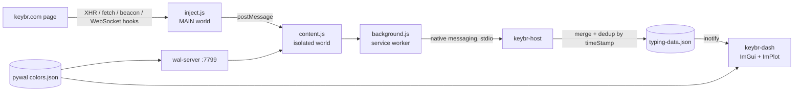

# keybr-ws

A live typing-practice dashboard for [keybr.com](https://www.keybr.com) on Linux and Hyprland: a Chromium extension captures each lesson, a native-messaging host files it, and a native C++ dashboard (Dear ImGui + ImPlot) charts WPM and accuracy as you type.

**Status:** working daily on desktop and laptop (Arch, Hyprland). Capturing the full history on page load and manual "download data" exports are solid. Capturing a single lesson the instant it finishes is the open part: keybr's per-lesson submission was not caught by the fetch/XHR hooks, so `inject.js` also hooks `sendBeacon` and WebSocket traffic and logs what it sees to the host (see "How it works").

<!-- MEDIA: GIF (10-15 s) of the dashboard window stacked above the keybr.com window in the scratchpad, finishing a lesson so the WPM/accuracy plot visibly updates. Name it docs/media/dashboard-live.gif -->
<!-- MEDIA: screenshot of the dashboard alone showing the WPM trend and accuracy plots with a pywal palette. Name it docs/media/dashboard.png -->

## What it does

- Plots WPM and accuracy per lesson and per day from your keybr history, in a native window that reloads the moment the data file changes.
- Themes keybr.com itself with your pywal palette (buttons, cards, the on-screen keyboard plate) and follows wallpaper changes within a couple of seconds. The functional finger-zone and learned-key colours are left alone.
- Lives in a Hyprland scratchpad: one key toggles the dashboard and the practice window together, launching whichever is missing.
- Keeps itself running: a supervisor respawns the dashboard if it dies, and a restart script clears the stale Chromium lock that makes the practice window silently fail to open.

## How it works



- **Extension.** A page-world script (`inject.js`) wraps the page's own network calls, because a content script in the isolated world cannot see the page's `fetch`. It matches result-shaped objects (numeric speed, a timestamp string, a histogram array) and relays them through the content script and service worker to the host.
- **Native host.** `keybr-host` is a small stdio program speaking Chromium's native-messaging framing. It merges incoming sessions into `typing-data.json`, de-duplicating by `timeStamp`, in one atomic write per batch. It also serves the current pywal palette back to the extension.
- **Dashboard.** `keybr-dash` watches the data directory and the pywal directory with inotify, reloads on change, and draws everything with ImPlot.

### Highlight: the frame cap that took the dashboard from 58% CPU to 4%

Two bugs in a row, both from a window that spends most of its life hidden in a scratchpad:

1. **A "crash" that was not one.** Hyprland's "Application Not Responding" dialog kept appearing. With vsync on, an occluded Wayland surface gets no frame callbacks, so `glfwSwapBuffers` blocks, the event loop stalls and the compositor's ping goes unanswered. The fix was `glfwSwapInterval(0)` with `glfwWaitEventsTimeout(0.1)`.
2. **The fix pinned a core.** Without vsync, nothing paces the loop, and the compositor floods the window with frame events, so the "10 fps idle" loop ran flat out: about 58% CPU on the laptop (more on the desktop), and the laptop reached 70 C. The fix is a hard cap in the render loop: take a timestamp at the top of the frame and, after `glfwSwapBuffers`, sleep out the remainder of a 33 ms (about 30 fps) period. Result: dashboard CPU 58% to 4%, laptop 70 C to 34 C.

The same pass found Chromium was forced into software rendering of keybr's animated page on the AMD laptop. `--disable-gpu` is only needed on NVIDIA under XWayland, so `keybr-launch` now adds it only when `lspci` shows an NVIDIA card.

### Other walls

- **Unreachable fetch.** The first live-capture design hooked `fetch` from the content script and never fired; isolated-world scripts get their own copy of the page globals. Moving the hook into a `world: "MAIN"` script fixed XHR/fetch capture.
- **Stale browser.** A Chromium already running on the same `--user-data-dir` ignores `--load-extension` changes, so edits to the extension appeared not to apply. The browser has to be fully killed before relaunch.
- **Throttled timers.** Page timers are throttled while keybr sits in a hidden scratchpad, so theming uses a `MutationObserver` rather than `setTimeout`. A class-agnostic fixer recolours near-white backgrounds, near-invisible text and near-white SVG fills by computed colour, since keybr's class names are hashed.
- **Silent launch failure.** A stale `SingletonLock` from an unclean exit makes the next launch do nothing. `keybr-launch` clears it, and `keybr-restart` clears it, relaunches and reports what it found through a desktop notification.
- **Extension ID without a copy-paste step.** An unpacked extension's ID is derived from its path (first 32 hex of sha256, mapped to a-p), so `install.sh` computes it and writes the native-messaging manifest from a template.

## Built with AI agents

- The CPU fix was found by measuring rather than guessing: the agent profiled the running process, saw it pinned despite the intended 10 fps loop, applied the frame cap, rebuilt, and re-measured CPU and temperature on both machines before calling it done.
- The live-capture problem was debugged with a diagnostic channel the agent added across the whole stack (page hook, background worker, host log), so the next real lesson would show exactly which call carries a result instead of leaving the next step to guesswork.
- Visual fixes to the theming were checked against real screenshots of the running window, which is how the "keyboard vanished to pure black" regression on a greyscale wallpaper was caught.

## Requirements

- Linux with Hyprland (the dashboard itself runs on any Wayland/X11 desktop with OpenGL 3.3)
- Chromium, a C++20 compiler, CMake 3.20+, git, GLFW (`glfw` on Arch), `inotify-tools` for the launch scripts
- Optional: pywal for theming
- ImGui (v1.91.5), ImPlot (v0.17) and nlohmann/json (v3.11.3) are fetched by CMake at configure time, so no third-party source is vendored here. Network access is needed for the first build.

## Install

```sh
git clone https://github.com/CipherNovaa/keybr-ws && cd keybr-ws
./install.sh            # builds, installs to ~/.local, writes the native-messaging manifest
```

The script installs `keybr-dash` and `keybr-host` to `~/.local/bin`, the extension to `~/.local/share/keybr-ext`, and registers the host with Chromium. The manifest comes from `config/com.keybr.host.json.template` with the host path and extension ID filled in.

## Usage

```sh
keybr-launch      # starts the dashboard (supervised) and the keybr.com window with the extension loaded
keybr-toggle      # launch what is missing, then toggle the Hyprland scratchpad
keybr-restart     # recover a practice window that will not open
```

Add the scratchpad rules and a keybind from `docs/hyprland-scratchpad.lua` to your Hyprland config. keybr's "download data" export is renamed to `typing-data.json` by a watcher in `keybr-launch`, which keeps the graph current even if live capture misses a lesson. Start `wal-server` (installed alongside) for pywal theming of the page.

## Credits and licence

MIT, see `LICENSE`. Built on [Dear ImGui](https://github.com/ocornut/imgui), [ImPlot](https://github.com/epezent/implot) (both MIT) and [nlohmann/json](https://github.com/nlohmann/json) (MIT). keybr.com is a third-party site; this project only reads the page you are already viewing and is not affiliated with it.
